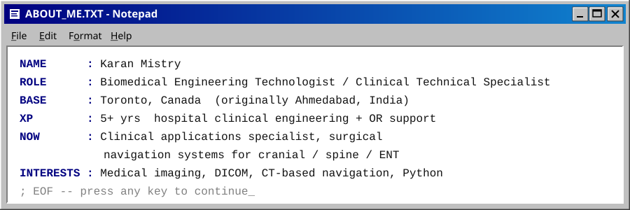

<div align="center">



<br/>

<a href="https://karan323.github.io/Karan_portfolio/"></a>
<a href="https://www.linkedin.com/in/karan-mistry33/"></a>
<a href="mailto:karanmistry333@gmail.com"></a>

</div>

<br/>



<br/>

```text
 ╔══════════════════════════════════════════════════════════════════════╗
 ║  C:\KARAN> dir /projects                                             ║
 ╚══════════════════════════════════════════════════════════════════════╝
```

| &nbsp;FILE | TYPE | DESCRIPTION |
|:--|:--|:--|
| `▸` [`HAND-TALK.GLV`](https://github.com/karan323/Hand-talk-glove-sign-to-Text-) | Jupyter | Sensor glove that converts sign language to text, so people who sign can be understood by anyone |
| `▸` [`DICOM-MR.DCM`](https://github.com/karan323/DICOM-MR) | Imaging | Working with MR scans in DICOM format: reading, viewing and handling medical image data |
| `▸` [`GUI-DEV.PY`](https://github.com/karan323/GUI-DEVELOPMENT-) | Jupyter | Build-your-own GUI from basic code |
| `▸` [`PORTFOLIO.HTM`](https://github.com/karan323/Karan_portfolio) | HTML | Source for my personal portfolio site |

```text
        4 File(s)        ∞ bytes of curiosity
        0 Dir(s)         plenty of room for what's next
```

<br/>

```text
 ┌─ SYSTEM.INI ──────────────────────────────────────────────────────────┐
 │ [clinical]                                                            │
 │ surgical_navigation = optical tracking, registration, OR workflow     │
 │ imaging             = CT, MRI, DICOM, PACS                            │
 │ field_support       = intraoperative case coverage, training, service │
 │                                                                       │
 │ [engineering]                                                         │
 │ languages           = Python, HTML/CSS, JavaScript                    │
 │ tools               = Jupyter, Git, OpenCV                            │
 │ hardware            = sensors, microcontrollers, medical equipment    │
 └───────────────────────────────────────────────────────────────────────┘
```

<p>
  
  
  
  
  
  
</p>

<br/>

<div align="center">

```text
╭──────────────────────────────────────────────╮
│   ★  THANKS FOR VISITING MY HOMEPAGE!  ★     │
│      best viewed in 800 x 600, 256 colors    │
╰──────────────────────────────────────────────╯
```


<sub>© 1999–2026 KARAN-OS · Made with a 56k modem and a lot of coffee</sub>

</div>
